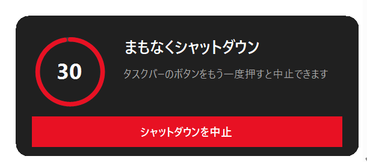
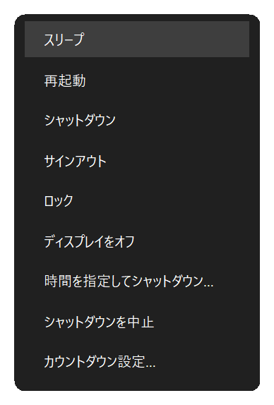
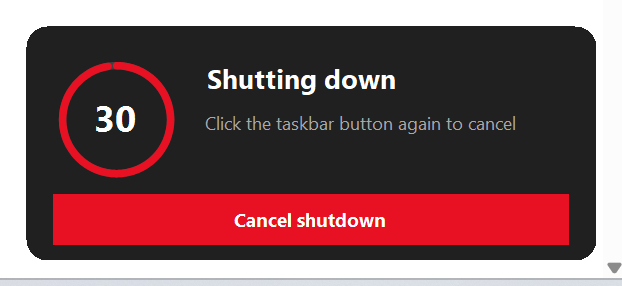
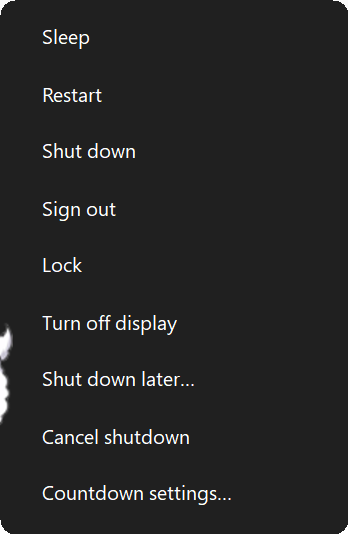
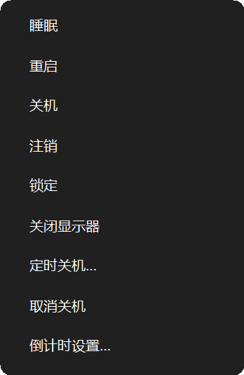
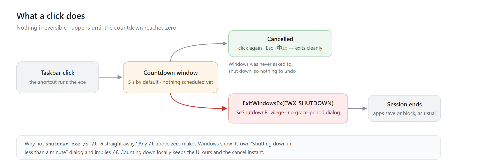
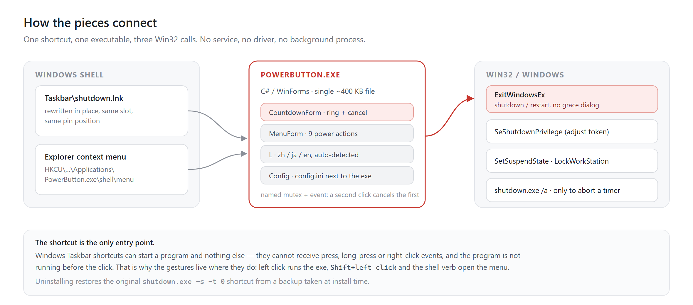

<div align="center">


# タスクバーの電源ボタン

**押し間違えても、取り消せるシャットダウン。**

[](https://github.com/doggybear233/taskbar-power-button/releases) [](#動作環境) [](LICENSE) [](#多言語)

[インストール](#インストール) · [使い方](#使い方) · [設定](#設定) · [仕組み](#仕組み) · [既知の制限](#既知の制限)

[English](README.md) · [中文](README.zh-CN.md) · **日本語**

</div>

---

電源ボタンを押すと、タスクバーのすぐ上、スタートの隣に小さなカードが出て、赤いリングが 5 秒を数え始めます。もう一度ボタンを押すか、`Esc` を押すか、カードの「シャットダウンを中止」を押せば消えます。何もしなければ、そのままシャットダウンします。

確認ダイアログは出ません。「もう一度押して確定」もありません。5 秒もらって、それを取り消すのも同じボタンです。

ボタンをダブルクリックするか、`Shift` を押しながらクリックすると、今度は電源メニューが開きます。スリープ、再起動、サインアウト、ロック、ディスプレイをオフ、時間を指定してシャットダウン。カードもメニューもプログラムが自分で描いているので、どの拡大率でも Windows 11 の一部のように見え、文言はシステムの表示言語に合わせます。


| 左クリック | 中止 | メニュー |
| :---: | :---: | :---: |
|  | もう一度ボタンを押す · <kbd>Esc</kbd> · 「シャットダウンを中止」 |  |

<sub>同じ画面とメニューの英語・中国語版：</sub>

| English | 中文 |
| :---: | :---: |
| <br> | <br> |

- 取り消すのに窓を探す必要はありません。押したボタンをもう一度押すだけです。
- カードは最前面の小さなウィンドウで、フォーカスを取りません。打っていた文字はそのまま元のアプリに入ります。
- 管理者権限は要らず、常駐プロセスも残りません。
- 書き込むのは 3 か所だけ——固定したショートカット、`%LOCALAPPDATA%\PowerButton\`、`HKCU` のシェル動詞 1 つです。

## インストール

### 動作環境

Windows 10 / 11、64 ビットでも 32 ビットでも（ARM64 も可）。インストーラーは **.NET Framework 4.x** 付属の `csc.exe` でその場でコンパイルします。この機能はサポート対象の Windows すべてに入っていますが、無効化されていた場合はスタックトレースではなく一行の説明を返します。

.NET SDK も Node もパッケージマネージャーも不要、**管理者権限も不要**です。

<details open>
<summary><b>Release から入れる（推奨）</b></summary>

1. [Releases](https://github.com/doggybear233/taskbar-power-button/releases) から `taskbar-power-button-1.0.0.zip` をダウンロードし、任意のフォルダーに展開します。
2. **`install.cmd`** をダブルクリックします。その 1 回だけ実行ポリシーを回避して起動し、結果を読めるようにウィンドウを開いたままにします。
3. タスクバーのアイコンがすぐ変わらない場合は、サインアウトして入り直してください。ショートカット自体はすでに書き換わっていて、エクスプローラーのアイコンキャッシュが古いだけです。

`install.cmd` をもう一度実行すればそのままアップグレードになります。元のショートカットのバックアップは初回のみです。

</details>

<details>
<summary><b><code>install.ps1</code> を直接ダブルクリックしないのはなぜ？</b></summary>

それでも動きますが、ダウンロードした zip から出したファイルには「Web のマーク」が付き、既定の `RemoteSigned` ポリシーは署名のないスクリプトを拒否します。`install.cmd` はその 1 手間を省き、展開したファイルのブロックも解除するので、あとから作るショートカットも影響を受けません。

手動でやるなら:

```powershell
powershell -NoProfile -ExecutionPolicy Bypass -File .\install.ps1
```

</details>

<details>
<summary><b>シャットダウンのボタンが <code>shutdown.lnk</code> でない場合</b></summary>

まず固定項目フォルダーの `shutdown.lnk` を探し、無ければそのフォルダーの全ショートカットを走査して、リンク先が `shutdown.exe` のものを選びます。名前を変えていたりローカライズされていても見つかります。

一つも見つからない場合（ピン留めが外れている可能性）はその旨を伝え、プログラム自体は導入したうえで、対象の指定方法を示します:

```powershell
.\install.ps1 -LnkPath "%APPDATA%\Microsoft\Internet Explorer\Quick Launch\User Pinned\TaskBar\MyPower.lnk"
```

書き換えるのはリンク先が `shutdown.exe` か本プログラムのショートカットだけで、それ以外は `-Force` を付けない限り触りません。実際に書き換えたパスは `backup\link.txt` に記録され、アンインストールはそれを使って復元します。

</details>

<details>
<summary><b>ソースから入れる</b></summary>

```powershell
git clone https://github.com/doggybear233/taskbar-power-button.git
cd taskbar-power-button
powershell -NoProfile -ExecutionPolicy Bypass -File .\install.ps1
```

`install.ps1` はアイコンを用意し、.NET Framework 付属の `csc.exe` で `src\PowerButton.cs` をコンパイルし、現在のショートカットをバックアップしてから同じ場所を書き換え、`HKCU` にシェル動詞を登録して、シェルを更新します。

</details>
## 使い方

| 操作 | 動作 |
| --- | --- |
| **左クリック** | カウントダウンのカードが出ます（既定 5 秒）。0 になってからシャットダウンします |
| **もう一度ボタンを押す** | 中止します。Windows 側には何も登録していないので、取り消す処理もありません |
| **`Esc`、「シャットダウンを中止」** | 上と同じ |
| **ボタンをダブルクリック** | 電源メニューが直接開きます。カードは一度も出ません |
| **`Shift` + 左クリック** | ダブルクリックと同じ |
| **カードの「電源メニュー」ボタン** | カードが開いているとき、ここから同じメニューへ |
| **マウスを重ねる** | エクスプローラーが描くショートカットのツールチップ |

メニューは **スリープ · 再起動 · シャットダウン · サインアウト · ロック · ディスプレイをオフ · 時間を指定してシャットダウン… · シャットダウンを中止 · カウントダウン設定…**。再起動も同じカウントダウンを通るので、中止できます。

クリックしてから 200 ミリ秒は何も出ません。この間にダブルクリックが来ればメニューへ直行し、シャットダウンのカードが一瞬ちらつくことはありません。シングルクリックの反応も変わりません。

ツールチップの文言も、カードとメニュー内のすべてのラベルもプログラムがシステム言語で生成するので、日本語・中国語・英語のどの環境でも自然な表記になります。

## 機能

| 機能 | なぜ必要か |
| --- | --- |
| 中止できるカウントダウン | 普通の電源ボタンは押した瞬間にすべてを終わらせます。こちらは 5 秒待つので、本当に切るときは 5 秒の損で済み、押し間違えたときは取り返せます |
| 同じボタンで取り消し | 閉じるダイアログも、探しに行くウィンドウもありません。押したボタンをもう一度押せば消えます |
| ダブルクリックでメニュー | スリープ、再起動、サインアウト、ロック、画面オフをスタートメニュー経由なしで実行できます |
| Windows の通知を出さない | Windows が「1 分以内にシャットダウンします」と出すのは、シャットダウンが*予約*されている間だけです。このツールは予約せず、0 になってから `ExitWindowsEx` を呼ぶので、システムのダイアログは出ません |
| 強制終了しない | `shutdown.exe /f` も `EWX_FORCE` も使いません。閉じるのを拒否するアプリは従来どおり「これらのアプリがシャットダウンを妨げています」画面に進むので、未保存の作業は消えません |
| 同じ場所・同じアイコン位置 | 既存の `.lnk` をその場で書き換えるので、ピン留めが二重になりません |
| 表示言語に追従 | カード、メニュー、ツールチップ、インストーラーのメッセージが Windows の表示言語に合わせます |
| 単一ファイル・ランタイム不要 | 約 400 KB の WinForms 実行ファイルを `csc.exe` でビルド。ランタイムの導入も常駐もしません |
| 32 ビット、64 ビット、ARM64 に入る | インストーラーが `Framework64`、`Framework`、`ProgramFiles(x86)` の順に探すので、1 つのパッケージで全アーキテクチャをまかなえます |
| 他のショートカットは触らない | リンク先が `shutdown.exe` か本プログラムのものだけを書き換えます。変えたパスは記録し、アンインストールで同じ場所へ戻します |

## 設定

メニューの **カウントダウン設定…** は `%LOCALAPPDATA%\PowerButton\config.ini` に書き込みます。

```ini
delay=5
lang=auto
```

`delay` は 0〜120 秒（`0` は即実行、非推奨）。`lang` は `auto` / `zh` / `ja` / `en`。

## コマンドライン

```
PowerButton.exe                     左クリック時の動作：カウントダウン後にシャットダウン
PowerButton.exe --menu              電源メニューを直接開く
PowerButton.exe --preview 30        30 秒のカウントダウンを表示するだけ（実行しない）
PowerButton.exe --cancel            メニューの「時間を指定してシャットダウン」を取り消す（shutdown /a）
PowerButton.exe --delay 8           今回だけ 8 秒にする
PowerButton.exe --lang ja|zh|en     今回だけ UI 言語を固定する
PowerButton.exe --selftest          SeShutdownPrivilege を取得できるか確認（0=正常、2=失敗）
PowerButton.exe --set-description <lnk> <テキスト>   ショートカットの説明を書き込む（インストーラー用）
PowerButton.exe --lnk-probe <lnk> <出力>            説明を読み戻して確認する
PowerButton.exe --label-out <キー> <ファイル>        現在の言語で 1 つの文言を書き出す
```

`--preview` は安全に UI を確認する方法です。実際のカウントダウン画面と中止処理を通り、最後にシャットダウンしないだけです。`--selftest` は `ExitWindowsEx` に必要な権限だけを確認し、こちらもシャットダウンしません。

## 仕組み





クリックでプロセスが起動し、プロセス自身が秒を数えます。0 になったときだけ `SeShutdownPrivilege` を有効化して `ExitWindowsEx(EWX_SHUTDOWN)` を呼びます。中止はウィンドウを閉じるだけで、Windows には何も登録していないため「何も起きなかった」状態に戻ります。

## ビルド

```powershell
C:\Windows\Microsoft.NET\Framework64\v4.0.30319\csc.exe /nologo /target:winexe /optimize+ `
  /codepage:65001 /win32manifest:src\app.manifest /win32icon:icons\power.ico `
  /out:%LOCALAPPDATA%\PowerButton\PowerButton.exe `
  /reference:System.dll /reference:System.Drawing.dll /reference:System.Windows.Forms.dll `
  src\PowerButton.cs
```

SDK もプロジェクトファイルも不要です。`csc.exe` は .NET Framework の一部で、Windows 10/11 には必ず入っています。`/codepage:65001` はソースが UTF-8 のため必要です。CI も同じコマンドを実行します（[`.github/workflows/build.yml`](.github/workflows/build.yml)）。

アイコンの再生成：

```powershell
powershell -NoProfile -ExecutionPolicy Bypass -File .\tools\make-icon.ps1
```

`icons\power.ico` には 9 サイズ（16 / 20 / 24 / 32 / 40 / 48 / 64 / 128 / 256）が入っており、それぞれを実寸で描画しています。タスクバーは 24〜40 px で表示するため、1 枚の大きな画像から縮小すると細い線が潰れます。ICO の各エントリーは手書きの 32 bpp DIB です。GDI+ とシェルは PNG 圧縮エントリーを受け付けず（空のタイルになります）、`GetHicon()` → `Icon.Save()` の往復ではアルファチャンネルが黙って失われます（黒い四角になります）。

## 多言語

UI は **中文 / 日本語 / English** の 3 言語で、既定では Windows の表示言語に従います。`ja` → 日本語、`zh` → 中国語、それ以外 → 英語。インストーラーのメッセージも同じ規則なので、日本語の環境では最初の行から日本語です。

判定には `CultureInfo.InstalledUICulture`（OS の表示言語）を使い、`CurrentUICulture` は使いません。この違いは重要です。ランチャー経由で起動したプロセス（PowerShell の子プロセスなど）は日本語の PC でも `en-US` を返すことがあり、それに従うと静かに言語を間違えます。

優先度の低い順に、次の方法で上書きできます。

```powershell
# %LOCALAPPDATA%\PowerButton\config.ini → lang=zh
$env:POWERBUTTON_LANG = 'zh'
PowerButton.exe --lang zh
```

フォントも言語に合わせて切り替えます（`Microsoft YaHei UI`、`Yu Gothic UI`、`Segoe UI`）。日本語の漢字が中国語の字形で描かれるのを避けるためです。メニューの幅は最も長い項目から測るので、長い日本語ラベルも切れません。言語を変えたあとにツールチップを更新したい場合は、`install.ps1` をもう一度実行してください。

## 既知の制限

- **タスクバーのボタンを右クリックすると開くのはエクスプローラーのメニューで、このアプリのメニューではありません。長押しも反応しません。** タスクバーのボタンはエクスプローラーのもので、ピン留めしたショートカットにできるのは「プログラムを起動する」ことだけです。しかもプログラムはクリックの*後*に起動するため、押下・長押し・右クリックのイベントを受け取れませんし、登録した動詞もピン留め項目には現れません。実現するには常駐プロセスと `WH_MOUSE_LL` のローレベルフック、解像度・DPI・マルチモニターの変化ごとのボタン矩形の再計算が必要です。本プロジェクトは常駐しない方針なので、メニューはダブルクリック、`Shift` + 左クリック、カード上のボタンから開きます。
- **メニューの「時間を指定してシャットダウン…」だけは今も `shutdown.exe` を使います。** 予約したシャットダウンはこのプロセスの終了後も生きている必要があるためです。残り 60 秒で Windows 自身のダイアログが出ますが、これは予約シャットダウンの仕様です。
- **実行中に DPI が変わるモニターには追従しません。** UI は起動時に取得した DPI で拡大縮小します。異なる拡大率のモニターへ移動すると、再起動するまでサイズが合わないことがあります。
- Windows 11 24H2 / 25H2、150 % 拡大で動作確認しています。Windows 10 でも動くはずですが（使用している API はすべて以前からあります）、実機確認はしていません。

## アンインストール

```powershell
powershell -NoProfile -ExecutionPolicy Bypass -File .\uninstall.ps1
```

`backup\link.txt` に記録されたショートカットを、インストール時のバックアップ（`shutdown.exe -s -t 0`）に戻し、`HKCU` の動詞とプログラム本体を削除します。`backup` フォルダーは再インストール用に残します。それも消すなら `-Purge` を付けてください:

```powershell
powershell -NoProfile -ExecutionPolicy Bypass -File .\uninstall.ps1 -Purge
```

それ以外には触れていません。

## クレジットとライセンス

- コード：[MIT](LICENSE)。
- アイコン：電源の字形は **Material Symbols** の `power_settings_new`（Google LLC、Apache-2.0）を白い円形バッジに改変し、9 サイズへラスタライズしたものです。[NOTICE](NOTICE) と [licenses/Apache-2.0.txt](licenses/Apache-2.0.txt) を参照してください。
- 選定段階では Material Symbols、Fluent UI System Icons、Lucide（ISC）、Tabler、Phosphor、Bootstrap Icons、Heroicons、Carbon、Ionicons（MIT / Apache-2.0）を比較しましたが、配布するのは Material Symbols の 1 種類だけです。
- Microsoft とは関係ありません。`shutdown.exe`、`ExitWindowsEx`、Windows は Microsoft のもので、本プロジェクトはそれらを呼び出しているだけです。
