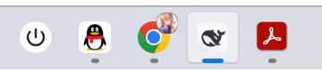
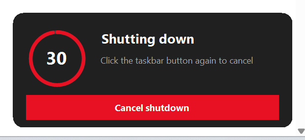
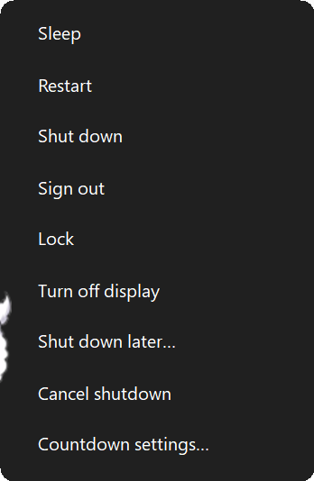
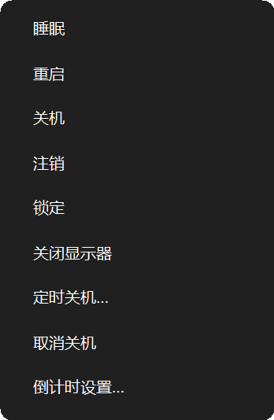
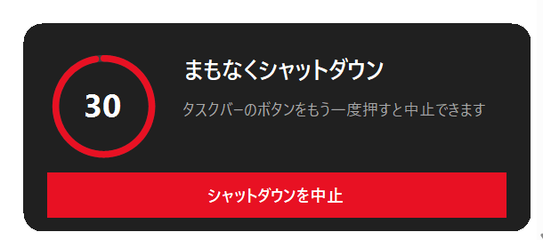
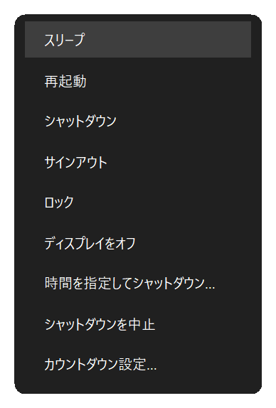
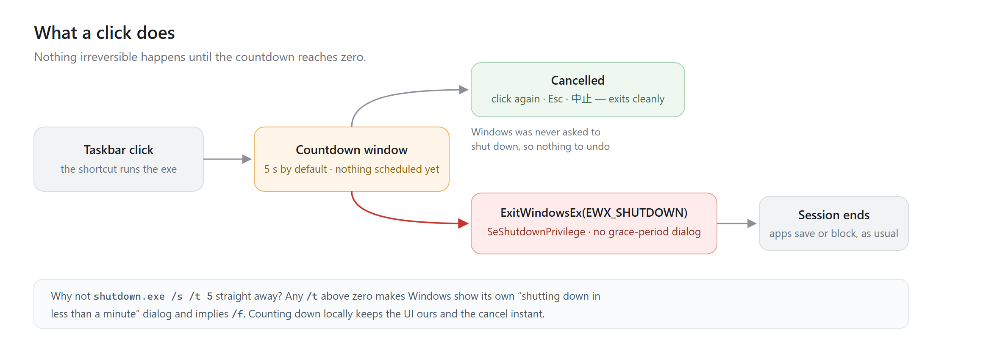
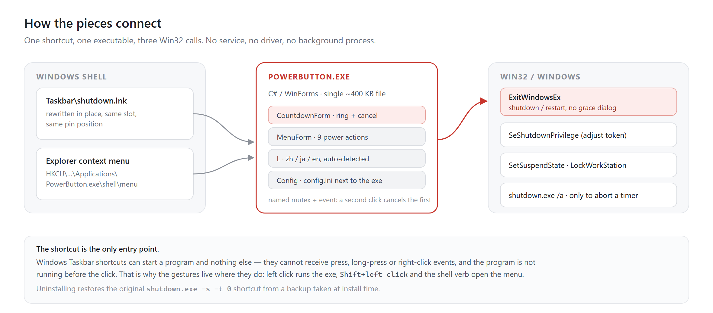

<div align="center">


# Taskbar Power Button

**A shutdown button you can take back.**

[](https://github.com/doggybear233/taskbar-power-button/releases) [](#requirements) [](LICENSE) [](#languages)

[Install](#install) · [Usage](#usage) · [Configuration](#configuration) · [How it works](#how-it-works) · [Limitations](#limitations)

**English** · [中文](README.zh-CN.md) · [日本語](README.ja.md)

</div>

---

Click the power button. A small card comes up just above the taskbar, next to Start, and a red ring counts five seconds down. Click the pin again, press `Esc`, or press Cancel in the card, and it goes away. Leave it alone and the machine shuts down.

There is no confirmation box, and nothing to press twice. You get five seconds, and the button you pressed takes them back.

Double-click the button, or hold `Shift` while you click, and you get the power menu instead: sleep, restart, sign out, lock, turn off the display, shut down later. The card and the menu are drawn by the program rather than by Explorer, so they come out looking like Windows 11 at any scaling, in whatever language your system speaks.



| Left click | Cancel | Menu |
| :---: | :---: | :---: |
|  | click the button again · <kbd>Esc</kbd> · or the red button in the window |  |

<sub>The same window and menu in 中文 and 日本語:</sub>

| 中文 | 日本語 |
| :---: | :---: |
| <br> | <br> |

- The cancel is the button you just pressed, not a window you have to go hunting for.
- The card is a small always-on-top window, so it does not take focus: whatever you were typing keeps going to the app you were typing in.
- No admin rights are involved, and no process stays behind.
- Install writes in three places only — the pinned shortcut, `%LOCALAPPDATA%\PowerButton\`, and one shell-verb key under `HKCU`.

## Install

### Requirements

Windows 10 or 11, 64-bit or 32-bit (ARM64 included). The installer compiles the program with `csc.exe` from **.NET Framework 4.x**, which every supported Windows already ships — and a machine where that feature was switched off gets one clear sentence instead of a stack trace.

No .NET SDK, no Node, no package manager, no administrator rights.

<details open>
<summary><b>From a release (recommended)</b></summary>

1. Download `taskbar-power-button-1.0.0.zip` from [Releases](https://github.com/doggybear233/taskbar-power-button/releases) and unzip it anywhere.
2. Double-click **`install.cmd`**. It runs the installer with the execution policy bypassed for that one run, and keeps the window open so you can read the result.
3. If the taskbar icon does not change immediately, sign out and back in — the shortcut is already correct, only Explorer's icon cache is stale.

Running `install.cmd` again upgrades in place. The original shortcut is only backed up on the first install.

</details>

<details>
<summary><b>Why not double-click <code>install.ps1</code> itself?</b></summary>

You can, but a file that came out of a downloaded zip carries the *mark of the web*, and the default `RemoteSigned` policy refuses unsigned scripts that have it. `install.cmd` sidesteps that in one step, and it unblocks the files it just unpacked so the shortcut it creates is not affected later.

By hand, if you prefer:

```powershell
powershell -NoProfile -ExecutionPolicy Bypass -File .\install.ps1
```

</details>

<details>
<summary><b>If your shutdown button is not called <code>shutdown.lnk</code></b></summary>

The installer looks for `shutdown.lnk` in the pinned taskbar folder first, then scans every shortcut there for one whose target is `shutdown.exe` — a renamed or localised shortcut is still found.

If it finds nothing (the button may have been unpinned), it says so, installs the program anyway, and tells you how to aim it at a shortcut:

```powershell
.\install.ps1 -LnkPath "%APPDATA%\Microsoft\Internet Explorer\Quick Launch\User Pinned\TaskBar\MyPower.lnk"
```

It only rewrites a shortcut whose target is `shutdown.exe` or this program; anything else is left alone unless you add `-Force`. Whatever path it changed is recorded in `backup\link.txt`, and that is what the uninstaller restores.

</details>

<details>
<summary><b>From source</b></summary>

```powershell
git clone https://github.com/doggybear233/taskbar-power-button.git
cd taskbar-power-button
powershell -NoProfile -ExecutionPolicy Bypass -File .\install.ps1
```

`install.ps1` copies or regenerates the icon, compiles `src\PowerButton.cs` with the `csc.exe` that ships with .NET Framework, backs up your current shortcut, rewrites it in place, registers a shell verb in `HKCU`, and refreshes the shell.

</details>
## Usage

| Gesture | What happens |
| --- | --- |
| **Left click** | Opens the countdown card (5 s by default); the machine shuts down when it reaches zero. |
| **Click the button again** | Cancels. Windows was never told to shut down, so there is nothing to abort. |
| **`Esc`, or *Cancel shutdown* in the card** | Same as above. |
| **Double-click the button** | Opens the power menu immediately; the card is never shown. |
| **`Shift` + left click** | Same as double-click. |
| **The *Power menu* button on the card** | Reaches the same menu while the card is already open. |
| **Hover** | Explorer's own tooltip for the shortcut. |

The menu offers **Sleep · Restart · Shut down · Sign out · Lock · Turn off display · Shut down later… · Cancel shutdown · Countdown settings…**. Restart goes through the same countdown, so it is cancellable too.

Nothing appears for the first 200 ms after a click. That is what lets a double-click go straight to the menu without a shutdown window flashing up in between; a single click still feels immediate.

The tooltip text and every label inside the card and menu are generated by the program in your system language, so they read naturally on a Japanese, Chinese or English machine.

## Features

| Feature | Why it exists |
| --- | --- |
| Cancellable countdown | A normal power button ends everything the moment you touch it. This one waits five seconds, which costs nothing when you meant it and saves you when you did not. |
| Cancel from the same button | No dialog to dismiss, no separate window to find: press the pin again and the countdown is gone. |
| Power menu on double-click | Sleep, restart, sign out, lock and display-off without a detour through the Start menu. |
| No Windows shutdown dialog | Windows shows its "shutting down in less than a minute" box whenever a shutdown is *scheduled*. This tool schedules nothing and calls `ExitWindowsEx` when the countdown reaches zero, so no system dialog appears. |
| No forced close | `shutdown.exe /f` and `EWX_FORCE` are never used, so an app that refuses to close still gets the usual "these apps are preventing shutdown" screen and unsaved work survives. |
| Same slot, same icon position | The existing `.lnk` is rewritten in place; no second pin appears. |
| Speaks your language | Card, menu, tooltip and installer messages follow the Windows display language. |
| One file, no runtime | A ~400 KB WinForms executable built by `csc.exe`. Nothing to install, nothing left running. |
| Installs on 32-bit, 64-bit and ARM64 | The installer probes `Framework64`, then `Framework`, then `ProgramFiles(x86)` for a compiler, so one download covers every architecture. |
| Leaves other shortcuts alone | A shortcut is only rewritten if it targets `shutdown.exe` or this program. The exact path is recorded, and the uninstaller restores that same path. |

## Configuration

**Countdown settings…** in the menu writes `%LOCALAPPDATA%\PowerButton\config.ini`:

```ini
delay=5
lang=auto
```

`delay` accepts 0–120 seconds (`0` means "shut down immediately" — not recommended). `lang` accepts `auto`, `zh`, `ja`, `en`.

## Command line

```
PowerButton.exe                     left-click behaviour: countdown, then shut down
PowerButton.exe --menu              open the power menu
PowerButton.exe --preview 30        show a 30 s countdown without shutting down
PowerButton.exe --cancel            abort a shutdown scheduled from the menu (shutdown /a)
PowerButton.exe --delay 8           use 8 s for this run
PowerButton.exe --lang ja|zh|en     override the UI language for this run
PowerButton.exe --selftest          check that SeShutdownPrivilege can be acquired (0 = ok, 2 = failed)
PowerButton.exe --set-description <lnk> <text>     write a shortcut description (used by the installer)
PowerButton.exe --lnk-probe <lnk> <out>          read a shortcut description back
PowerButton.exe --label-out <key> <file>         export one UI string in the current language
```

`--preview` is the safe way to look at the UI: it runs the real countdown window and cancel logic and simply never shuts down. `--selftest` verifies the privilege `ExitWindowsEx` needs, without shutting down either.

## How it works





A click starts the process; the process counts down; only at zero does it raise `SeShutdownPrivilege` and call `ExitWindowsEx(EWX_SHUTDOWN)`. Cancelling closes the window, and because nothing was ever registered with Windows, cancelling really means *nothing happened*.

## Build

```powershell
C:\Windows\Microsoft.NET\Framework64\v4.0.30319\csc.exe /nologo /target:winexe /optimize+ `
  /codepage:65001 /win32manifest:src\app.manifest /win32icon:icons\power.ico `
  /out:%LOCALAPPDATA%\PowerButton\PowerButton.exe `
  /reference:System.dll /reference:System.Drawing.dll /reference:System.Windows.Forms.dll `
  src\PowerButton.cs
```

No SDK and no project file: `csc.exe` is part of .NET Framework, which every Windows 10/11 machine already has. `/codepage:65001` is required because the source is UTF-8. CI runs the same command — see [`.github/workflows/build.yml`](.github/workflows/build.yml).

Regenerating the icon:

```powershell
powershell -NoProfile -ExecutionPolicy Bypass -File .\tools\make-icon.ps1
```

`icons\power.ico` holds nine sizes (16, 20, 24, 32, 40, 48, 64, 128, 256), each rasterised at its own size rather than downscaled from one bitmap, because the taskbar renders 24–40 px and thin strokes turn to mush when sampled down. Every ICO entry is a hand-written 32 bpp DIB: GDI+ and the shell reject PNG-compressed entries (blank tile), and an `GetHicon()` → `Icon.Save()` round trip silently drops the alpha channel (black square).

## Languages

The interface ships in **中文 / 日本語 / English** and follows the Windows display language: `ja` → Japanese, `zh` → Chinese, anything else → English. The installer's own messages follow the same rule, so a Japanese machine is talked to in Japanese from the first line.

Detection reads `CultureInfo.InstalledUICulture` — the OS display language — rather than `CurrentUICulture`. That distinction matters: a process started from some launchers (including a PowerShell child) reports `en-US` even on a Japanese machine, which would silently give you the wrong language.

Override it, in ascending priority:

```powershell
# %LOCALAPPDATA%\PowerButton\config.ini → lang=zh
$env:POWERBUTTON_LANG = 'zh'
PowerButton.exe --lang zh
```

Fonts switch with the language (`Microsoft YaHei UI`, `Yu Gothic UI`, `Segoe UI`) so Japanese kanji are not drawn with Chinese glyph shapes, and the menu measures its widest item so long Japanese labels are never clipped. To refresh the tooltip after switching, re-run `install.cmd`.

## Limitations

- **Right-clicking the taskbar button opens Explorer's menu, not ours, and long-press does nothing.** A taskbar button belongs to Explorer, and a pinned shortcut can only start a program; this program starts after the click, so it never sees the press, the hold, or the right-click, and the shell verb it registers does not show up on the pinned item. Handling real gestures would take a resident process, a `WH_MOUSE_LL` hook, and a button rectangle recomputed on every resolution, DPI or monitor change. This project stays resident-free on purpose, so the menu is reached by double-click, by `Shift` + click, or from the button on the card.
- **"Shut down later…" is the one path that still uses `shutdown.exe`**, because the scheduled shutdown has to outlive this process. At the 60-second mark Windows shows its own dialog — that is inherent to scheduled shutdowns.
- **Per-monitor DPI switching is not handled live.** The UI scales from the DPI it sees at startup; moving the window to a monitor with a different scale factor may leave it slightly large or small until restart.
- Tested on Windows 11 24H2/25H2 at 150 % scaling. Windows 10 should work (the APIs are all long-standing) but has not been tested.

## Uninstall

```powershell
powershell -NoProfile -ExecutionPolicy Bypass -File .\uninstall.ps1
```

This restores the shortcut recorded in `backup\link.txt` from the backup taken at install time (`shutdown.exe -s -t 0`), deletes the `HKCU` verb and removes the program files. The `backup` folder is kept so you can install again later — add `-Purge` to delete it too:

```powershell
powershell -NoProfile -ExecutionPolicy Bypass -File .\uninstall.ps1 -Purge
```

Nothing else was ever touched.

## Credits & licenses

- Code: [MIT](LICENSE).
- Icon: the power glyph is `power_settings_new` from **Material Symbols** (Google LLC, Apache-2.0), modified into a white disc badge and rasterised into the nine ICO sizes. See [NOTICE](NOTICE) and [licenses/Apache-2.0.txt](licenses/Apache-2.0.txt).
- The candidate glyphs in `icons/raw/` came from Material Symbols, Fluent UI System Icons, Lucide (ISC), Tabler, Phosphor, Bootstrap Icons, Heroicons, Carbon and Ionicons (MIT/Apache-2.0) while choosing a design; only the Material Symbols glyph is shipped.
- Not affiliated with Microsoft. `shutdown.exe`, `ExitWindowsEx` and Windows are Microsoft's; this project only drives them.
