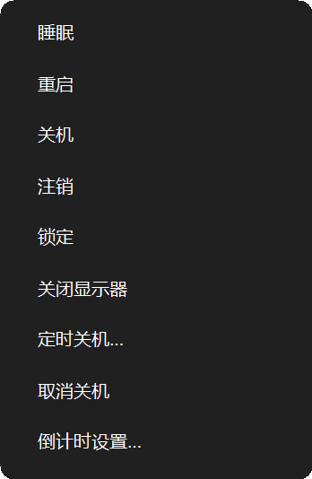
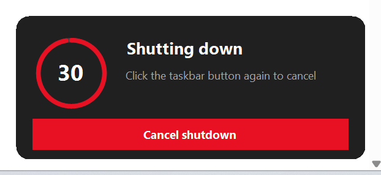
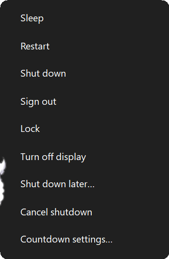
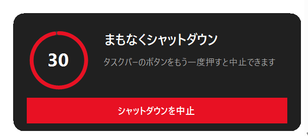
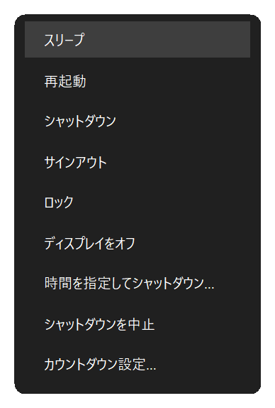
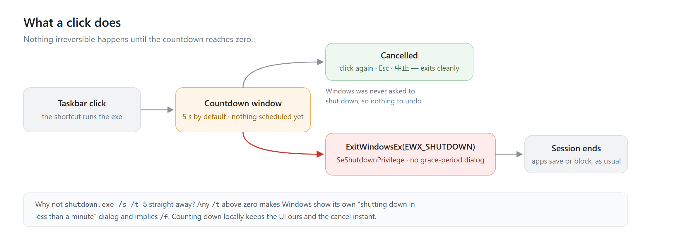
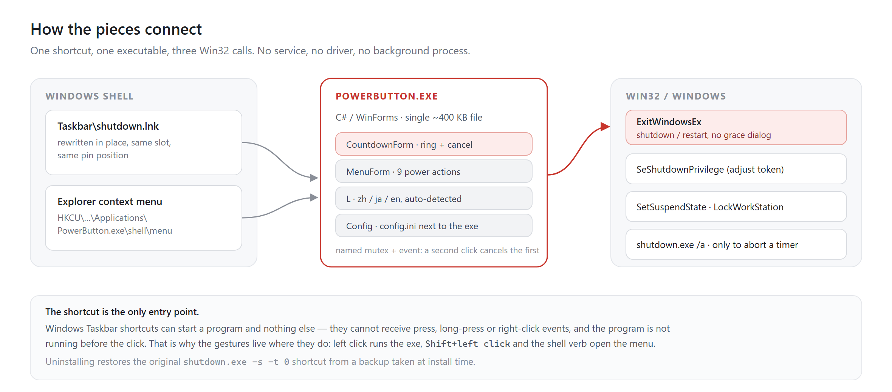

<div align="center">


# 任务栏电源按钮

**一个可以反悔的关机按钮。**

[](https://github.com/doggybear233/taskbar-power-button/releases) [](#环境要求) [](LICENSE) [](#多语言)

[安装](#安装) · [用法](#用法) · [设置](#设置) · [工作原理](#工作原理) · [已知限制](#已知限制)

[English](README.md) · **中文** · [日本語](README.ja.md)

</div>

---

点一下电源按钮，任务栏上方、开始按钮旁边会浮出一张小卡片，红色圆环正在倒数五秒。再点一下按钮，或者按 `Esc`、点卡片里的「取消关机」，它就收起来；什么都不做，时间到了电脑就关机。

没有确认框，也不用点第二次才算数。你得到五秒钟，而收回这五秒的就是刚才按下的那个按钮。

双击按钮，或者按住 `Shift` 再点，出来的直接是电源菜单：睡眠、重启、注销、锁定、关闭显示器、定时关机。卡片和菜单都是程序自己画的，所以在任何缩放比例下都像 Windows 11 的一部分，文案也跟着系统语言走。


| 左键 | 取消 | 菜单 |
| :---: | :---: | :---: |
|  | 再点一次按钮 · <kbd>Esc</kbd> · 点「取消关机」 |  |

<sub>同一窗口与菜单的英文、日文版本：</sub>

| English | 日本語 |
| :---: | :---: |
| <br> | <br> |

- 取消不用满屏幕找窗口，按下的那个按钮再按一次就行。
- 卡片是个置顶小窗，不抢焦点：你正在打的字还是打进原来那个程序。
- 不需要管理员权限，也不会留下后台进程。
- 安装只写三个地方——固定的快捷方式、`%LOCALAPPDATA%\PowerButton\`，以及 `HKCU` 下的一条外壳动词键。

## 安装

### 环境要求

Windows 10 / 11，64 位或 32 位（ARM64 也可以）。安装脚本用 **.NET Framework 4.x** 自带的 `csc.exe` 现场编译——这个组件每台受支持的 Windows 都有；万一被关掉了，脚本会给一句人话，而不是一段堆栈。

不需要 .NET SDK，不需要 Node，不需要包管理器，安装**不需要**管理员权限。

<details open>
<summary><b>从 Release 安装（推荐）</b></summary>

1. 到 [Releases](https://github.com/doggybear233/taskbar-power-button/releases) 下载 `taskbar-power-button-1.0.0.zip`，解压到任意目录。
2. 双击 **`install.cmd`**。它只对这一次运行绕过执行策略，跑完会停住窗口让你看清结果。
3. 如果任务栏图标没立刻变，注销再登录一次——快捷方式其实已经改好了，只是资源管理器的图标缓存没刷新。

重跑 `install.cmd` 即原地升级。原快捷方式只在第一次安装时备份。

</details>

<details>
<summary><b>为什么不直接双击 <code>install.ps1</code>？</b></summary>

可以，但刚从 zip 解压出来的文件带着「来自网络」标记，默认的 `RemoteSigned` 策略会拒绝执行这种未签名脚本。`install.cmd` 一步绕开这个问题，顺手把解压出来的文件都解锁，后面生成的快捷方式也不会被牵连。

想手动来也可以：

```powershell
powershell -NoProfile -ExecutionPolicy Bypass -File .\install.ps1
```

</details>

<details>
<summary><b>如果你的关机按钮不叫 <code>shutdown.lnk</code></b></summary>

脚本先在固定项目录里找 `shutdown.lnk`；找不到就扫描该目录下所有快捷方式，挑目标为 `shutdown.exe` 的那一个——改过名字或本地化过的也能认出来。

如果一个都找不到（那个按钮可能已经被取消固定），它会明说，程序照样装好，并告诉你怎样指定目标：

```powershell
.\install.ps1 -LnkPath "%APPDATA%\Microsoft\Internet Explorer\Quick Launch\User Pinned\TaskBar\MyPower.lnk"
```

它只会改写目标是 `shutdown.exe` 或本程序的快捷方式，其它一律不动（除非加 `-Force`）。实际改了哪个文件会记进 `backup\link.txt`，卸载时就是按它还原的。

</details>

<details>
<summary><b>从源码安装</b></summary>

```powershell
git clone https://github.com/doggybear233/taskbar-power-button.git
cd taskbar-power-button
powershell -NoProfile -ExecutionPolicy Bypass -File .\install.ps1
```

`install.ps1` 会准备图标 → 用 .NET Framework 自带的 `csc.exe` 编译 `src\PowerButton.cs` → 备份原快捷方式 → 原地改写 → 注册 `HKCU` 外壳动词 → 刷新外壳。

</details>
## 用法

| 操作 | 结果 |
| --- | --- |
| **左键单击** | 浮出倒计时卡片（默认 5 秒），数到 0 才关机 |
| **再点一次按钮** | 取消。系统侧本来就没排过关机，没什么需要中止 |
| **`Esc`，或卡片上的「取消关机」** | 同上 |
| **双击按钮** | 直接打开电源菜单，卡片根本不会出现 |
| **`Shift` + 左键** | 和双击一样 |
| **卡片上的「电源菜单」按钮** | 卡片已经打开时，从这里进同一个菜单 |
| **鼠标悬停** | 资源管理器给快捷方式画的提示气泡 |

菜单里有 **睡眠 · 重启 · 关机 · 注销 · 锁定 · 关闭显示器 · 定时关机… · 取消关机 · 倒计时设置…**。重启也走同一条倒计时，同样可以取消。

按下之后头 200 毫秒什么都不显示。这样双击能直接进菜单，中间不会闪一下关机卡片；单击也还是那么跟手。

悬停说明、卡片和菜单里的文案都由程序按系统语言生成，所以在日文、中文、英文机器上读起来都是母语写法。

## 功能

| 功能 | 为什么要有 |
| --- | --- |
| 可取消的倒计时 | 普通电源按钮一按就把一切结束掉。这个按钮先等五秒：真要走，这五秒不亏；手滑了，还有余地 |
| 就在原处取消 | 没有弹框要点，也没有窗口要找，按回同一个按钮就撤 |
| 双击进菜单 | 睡眠、重启、注销、锁定、关屏，不必绕去开始菜单 |
| 不弹 Windows 关机提示 | Windows 只在关机被*排期*时才弹「将在 1 分钟内关机」。本程序不预排，倒计时结束才调 `ExitWindowsEx`，所以不弹 |
| 从不强杀程序 | 从不使用 `shutdown.exe /f` 或 `EWX_FORCE`，拒绝关闭的程序仍会走系统那句「这些应用阻止关机」，未保存的工作保得住 |
| 原位替换 | 原地改写已有的 `.lnk`，不多出第二个固定项 |
| 说你的语言 | 卡片、菜单、悬停说明和安装脚本的提示都跟随 Windows 显示语言 |
| 单文件、无运行时 | 约 400 KB 的 WinForms 程序，用 `csc.exe` 现场编译；不用装运行时，也不留后台进程 |
| 32 位、64 位、ARM64 都能装 | 安装脚本依次探测 `Framework64`、`Framework`、`ProgramFiles(x86)`，一个包覆盖所有架构 |
| 不碰别人的快捷方式 | 只改写目标是 `shutdown.exe` 或本程序的快捷方式；改的是哪个文件会记下来，卸载时还原到同一处 |

## 设置

菜单里的 **倒计时设置…** 会写入 `%LOCALAPPDATA%\PowerButton\config.ini`：

```ini
delay=5
lang=auto
```

`delay` 取 0–120 秒（`0` 表示立即执行，不建议）。`lang` 取 `auto` / `zh` / `ja` / `en`。

## 命令行

```
PowerButton.exe                     左键行为：倒计时后关机
PowerButton.exe --menu              直接打开电源菜单
PowerButton.exe --preview 30        只显示 30 秒倒计时，不关机
PowerButton.exe --cancel            取消菜单里「定时关机」排下的关机（shutdown /a）
PowerButton.exe --delay 8           本次用 8 秒
PowerButton.exe --lang ja|zh|en     本次强制界面语言
PowerButton.exe --selftest          检查能否取得 SeShutdownPrivilege（0=正常，2=失败）
PowerButton.exe --set-description <lnk> <文本>   写快捷方式备注（安装脚本用）
PowerButton.exe --lnk-probe <lnk> <输出>         把备注读出来核对
PowerButton.exe --label-out <键> <文件>          按当前语言导出一条文案
```

`--preview` 是安全的看界面方式：完整走倒计时窗口与取消逻辑，只是最后不关机。`--selftest` 只验证 `ExitWindowsEx` 需要的权限，同样不关机。

## 工作原理





点击启动进程；进程自己数秒；只有到 0 时才提升 `SeShutdownPrivilege` 并调用 `ExitWindowsEx(EWX_SHUTDOWN)`。取消就是关掉窗口——因为从未向 Windows 注册过任何东西，取消意味着**什么都没发生**。

## 编译

```powershell
C:\Windows\Microsoft.NET\Framework64\v4.0.30319\csc.exe /nologo /target:winexe /optimize+ `
  /codepage:65001 /win32manifest:src\app.manifest /win32icon:icons\power.ico `
  /out:%LOCALAPPDATA%\PowerButton\PowerButton.exe `
  /reference:System.dll /reference:System.Drawing.dll /reference:System.Windows.Forms.dll `
  src\PowerButton.cs
```

不需要 SDK、不需要工程文件：`csc.exe` 是 .NET Framework 的一部分，任何 Win10/11 都有。`/codepage:65001` 是因为源码是 UTF-8。CI 跑的是同一条命令，见 [`.github/workflows/build.yml`](.github/workflows/build.yml)。

重新生成图标：

```powershell
powershell -NoProfile -ExecutionPolicy Bypass -File .\tools\make-icon.ps1
```

`icons\power.ico` 内含 9 个尺寸（16 / 20 / 24 / 32 / 40 / 48 / 64 / 128 / 256），每个都按自身尺寸原生渲染而不是从一张大图缩出来——任务栏用 24–40 px，缩小采样会把细笔画糊掉。每个 ICO 条目都是手写的 32bpp DIB：GDI+ 和外壳不认 PNG 压缩条目（显示空白 tile），而 `GetHicon()` → `Icon.Save()` 往返会静默丢掉 alpha（变成黑方块）。

## 多语言

界面有 **中文 / 日本語 / English** 三套文案，默认跟随 Windows 显示语言：`ja` → 日文，`zh` → 中文，其他 → 英文。安装脚本自己的提示也用同一套规则，所以日文系统上从第一行就是日文。

判断用的是 `CultureInfo.InstalledUICulture`（系统显示语言），而不是 `CurrentUICulture`。这个区别是必要的：某些启动器起的进程（包括从 PowerShell 里起的子进程）在日文机器上会报 `en-US`，照它走就会悄悄选错语言。

覆盖方式，优先级从低到高：

```powershell
# %LOCALAPPDATA%\PowerButton\config.ini → lang=zh
$env:POWERBUTTON_LANG = 'zh'
PowerButton.exe --lang zh
```

字体随语言切换（`Microsoft YaHei UI`、`Yu Gothic UI`、`Segoe UI`），避免日文汉字被中文字形渲染；菜单宽度按最长的一条量出来，日文长标签不会被截断。换语言后想刷新悬停说明，重跑一次 `install.ps1`。

## 已知限制

- **右键任务栏按钮弹出的是资源管理器的菜单，不是我们的；长按也没有反应。** 任务栏按钮属于资源管理器，而固定快捷方式只能「启动一个程序」；程序是在点击*之后*才启动的，收不到按下、长按和右键，注册好的外壳动词也不会出现在固定项上。真要支持这些手势，得有常驻进程、`WH_MOUSE_LL` 低级鼠标钩子，还要在分辨率、DPI、多屏变化时重算按钮矩形。本项目刻意不常驻，所以菜单靠双击、`Shift` + 左键，或者卡片上的那个按钮进入。
- **菜单里的「定时关机…」是唯一仍走 `shutdown.exe` 的路径**，因为排期的关机必须在本进程退出后继续存活；到剩余 60 秒时 Windows 会弹它自己的提示框——这是排期关机的固有行为。
- **不处理运行中切换 DPI 的显示器。** 界面按启动时的 DPI 缩放；把窗口拖到不同缩放比的显示器上，可能需要重开才恢复合适大小。
- 在 Windows 11 24H2/25H2、150% 缩放下测试。Windows 10 应当可用（用到的 API 都很老），但未实测。

## 卸载

```powershell
powershell -NoProfile -ExecutionPolicy Bypass -File .\uninstall.ps1
```

把 `backup\link.txt` 里记录的那个快捷方式还原成安装时备份的原版（`shutdown.exe -s -t 0`），删掉 `HKCU` 里的动词和程序文件。`backup` 目录会保留，方便以后重装；要连它一起删就加 `-Purge`：

```powershell
powershell -NoProfile -ExecutionPolicy Bypass -File .\uninstall.ps1 -Purge
```

除此之外没有改动任何地方。

## 致谢与许可

- 代码：[MIT](LICENSE)。
- 图标：电源字形取自 **Material Symbols** 的 `power_settings_new`（Google LLC，Apache-2.0），改成白圆底徽标并栅格化成 9 个尺寸。见 [NOTICE](NOTICE) 与 [licenses/Apache-2.0.txt](licenses/Apache-2.0.txt)。
- 选型阶段比较过 Material Symbols、Fluent UI System Icons、Lucide（ISC）、Tabler、Phosphor、Bootstrap Icons、Heroicons、Carbon、Ionicons（MIT/Apache-2.0）；最终只分发 Material Symbols 那一款。
- 与 Microsoft 无关。`shutdown.exe`、`ExitWindowsEx` 和 Windows 属于 Microsoft，本项目只是调用它们。
